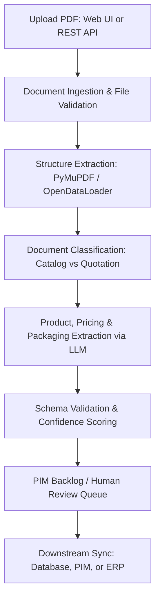

# CatalogFlow

AI-powered document processing pipeline and web application that extracts structured product, commercial, and packaging records from catalog and brochure PDFs.

**Live Application:** [https://catalogflow-mu.vercel.app](https://catalogflow-mu.vercel.app)

[](https://catalogflow-mu.vercel.app)
[](https://www.python.org/downloads/)
[](https://fastapi.tiangolo.com)
[](https://langchain-ai.github.io/langgraph/)

---

## Overview

> **Live Deployment:** Access the interactive web interface at [https://catalogflow-mu.vercel.app](https://catalogflow-mu.vercel.app) to test PDF extraction in real time.

CatalogFlow automates the manual extraction of product data from supplier catalogs, price lists, and commercial brochures. It reads unstructured PDF documents, identifies document types, and parses product details into normalized, schema-validated JSON records ready for direct ingestion into databases, Product Information Management (PIM) systems, or ERP platforms.

Every extracted attribute is linked to source evidence (page number and original text snippet) so that human reviewers can verify accuracy. If data is not present in the document, it remains empty rather than being hallucinated.

---

## The Problem

Suppliers frequently share product information in PDF catalogs and brochures designed for human reading rather than machine consumption. A single catalog often contains dozens or hundreds of items, with technical specifications, pricing tiers, and packaging dimensions scattered across multi-column layouts, tables, and images.

Manual entry from these documents is slow, prone to transcription errors, and difficult to scale across varying vendor formats. CatalogFlow solves this by providing an automated extraction workflow with a web interface for interactive uploads and a REST API for programmatic integrations.

---

## How It Works

CatalogFlow processes PDF documents through a multi-stage pipeline:



1. **Ingest and Validate:** Verifies file size and computes SHA-256 hashes for deduplication.
2. **Parse Structure:** Extracts markdown text, bounding boxes, images, and tables with automated fallbacks.
3. **Classify:** Identifies whether the document is a product catalog or a commercial quotation.
4. **Extract:** Uses language models to parse product attributes, commercial terms, and packaging dimensions.
5. **Validate:** Enforces schema rules, checks SKU completeness, and flags items requiring review.
6. **Export:** Returns structured JSON and logs reviewable records into the backlog store.

---

## Extracted Data Categories

| Category | Description | Key Fields |
| :--- | :--- | :--- |
| **Product Master Data** | Core product identity and attributes | Vendor SKU, product name, variant, description, categories |
| **Commercial Data** | Purchasing and commercial terms | Unit price, currency (INR / ₹), minimum order quantity (MOQ), incoterms (e.g. Ex-Works Hyderabad), payment terms |
| **Packaging & Logistics Data** | Physical specifications and freight | Length, width, height, unit of measure, cubic meters (CBM), 40HQ container capacity |
| **Source Evidence** | Audit trail for human verification | Source page number, raw text excerpt, extraction confidence score |

---

## Key Features

- **Interactive Web UI:** Modern dark-mode interface with drag-and-drop PDF upload, progress indicators, summary statistics, and expandable product cards.
- **REST API:** Simple HTTP endpoints for integrating document parsing into external applications and automated backend jobs.
- **Dual Document Support:** Specialized processing paths for both broad product catalogs and specific commercial quotations.
- **Evidence-Grounded Extraction:** Every extracted data point references its source page and text block for rapid auditability.
- **SKU Deduplication:** Automatic grouping and matching of product records by vendor SKU.
- **Quality Evaluation & Validation:** Automated page quality scoring and schema validation to flag missing fields.
- **PIM Review Queue:** Persistent backlog storage for extractions that require manual review or reprocessing.
- **Flexible PDF Engine:** Combines PyMuPDF and OpenDataLoader for reliable text, table, and layout extraction across all environments.

---

## Technology Stack

| Component | Technology | Role |
| :--- | :--- | :--- |
| **Web Framework** | FastAPI | REST API endpoints and static asset serving |
| **Frontend** | Vanilla HTML5, CSS3, JavaScript | Responsive dark-mode web application interface |
| **Workflow Engine** | LangGraph, LangChain | State machine orchestration and node transitions |
| **Language Models** | OpenRouter (Configurable LLMs) | Information extraction, structuring, and schema mapping |
| **PDF Extraction** | PyMuPDF (fitz), PyMuPDF4LLM | Robust layout parsing, table reconstruction, and markdown conversion |
| **Vector Database** | Qdrant | Optional vector indexing for semantic chunk retrieval |
| **Runtime & Tooling** | Python 3.12, uv | Package management, virtual environments, and execution |

---

## API Reference

### Health Check

```http
GET /api/health
```

**Response (200 OK):**
```json
{
  "status": "ok",
  "service": "CatalogFlow"
}
```

---

### Extract Product Data

```http
POST /api/extract
```

Accepts a `multipart/form-data` request with a PDF file.

**Parameters:**
- `file` (required): Binary PDF file to process.

**Response (200 OK):**
```json
{
  "run_id": "51e80600-9a50-42f1-9fe0-f73491e8e23d",
  "document_id": "doc_95603e3737a5f9f7",
  "document_type": "quotation",
  "classification_reason": "Detected commercial terms: moq, inr, gst",
  "classification_confidence": 0.75,
  "page_count": 3,
  "processing_status": "awaiting_pim_ppv_review",
  "warnings": [],
  "vendor": {
    "vendor_name": "Deccan Precision Tools Pvt Ltd",
    "address": "Plot 42, IDA Cherlapally, Hyderabad, Telangana 500051",
    "country_code": "IN",
    "currency_code": "INR",
    "incoterm_code": "Ex-Works Hyderabad",
    "payment_terms": "Net 30 Days"
  },
  "products": [
    {
      "vendor_sku": "DPT-HYD-500",
      "vendor_product_name": "Industrial Submersible Pump 5HP",
      "confidence": 0.94,
      "offers": [
        {
          "price_amount": 18500.00,
          "currency_code": "INR",
          "minimum_quantity": 2
        }
      ],
      "packaging": [
        {
          "length": 55.0,
          "width": 35.0,
          "height": 30.0,
          "dimension_uom_code": "CM",
          "cbm": 0.0578
        }
      ],
      "source": {
        "page": 1,
        "raw_text": "Model DPT-HYD-500: Industrial Submersible Pump 5HP. Price: Rs. 18,500 MOQ: 2 units. Ex-Works Hyderabad."
      }
    }
  ],
  "ppv_valid": true,
  "visual_review_required": false
}
```

---

## Configuration

Environment variables can be configured in a `.env` file at the project root:

| Variable | Required | Default | Description |
| :--- | :--- | :--- | :--- |
| `OPENROUTER_API_KEY` | Optional | None | API key for OpenRouter models (required for live AI extraction) |
| `OPENROUTER_MODEL` | Optional | `nvidia/nemotron-3-ultra-550b-a55b:free` | Model identifier to use for extraction |
| `ENABLE_LLM_CALLS` | Optional | `false` | Set to `true` to enable live LLM requests |
| `ENABLE_CLASSIFIER_LLM` | Optional | `false` | Use an LLM for document classification instead of local heuristics |
| `MAX_LLM_REQUESTS_PER_RUN` | Optional | `3` | Maximum LLM requests permitted per pipeline execution |
| `MAX_LLM_REQUESTS_PER_DAY` | Optional | `20` | Daily limit on LLM requests to manage costs |
| `QDRANT_URL` | Optional | None | Qdrant vector database URL (optional indexing) |
| `QDRANT_API_KEY` | Optional | None | Qdrant API key |
| `QDRANT_COLLECTION` | Optional | `catalog_chunks` | Name of the collection in Qdrant |
| `CATALOG_EXTRACTION_BATCH_SIZE` | Optional | `3` | Number of document chunks per extraction batch |

---

## Local Development

### Prerequisites

- Python 3.12 or newer
- [uv](https://github.com/astral-sh/uv) package manager

### Setup

1. Clone the repository:
   ```bash
   git clone https://github.com/sohansai/catalogflow.git
   cd catalogflow
   ```

2. Install dependencies:
   ```bash
   uv sync
   ```

3. Configure environment variables (optional):
   ```bash
   cp .env.example .env
   ```

4. Start the development server:
   ```bash
   uv run uvicorn api.index:app --reload --port 8000
   ```

5. Open [http://localhost:8000](http://localhost:8000) in your browser to access the web UI.

---

## Additional Documentation

- [Output Schema Reference](docs/outputs.md): Details on product record structures, offer models, and source evidence fields.
- [Glossary of Terms](docs/glossary.md): Terminology definitions and field mapping guidelines.
- [Integration Guide](docs/integrations.md): Instructions for connecting CatalogFlow outputs to PIM, ERP, and database systems.
- [System Architecture](docs/architecture.md): Deep dive into graph state transitions, validation nodes, and fallback strategies.
